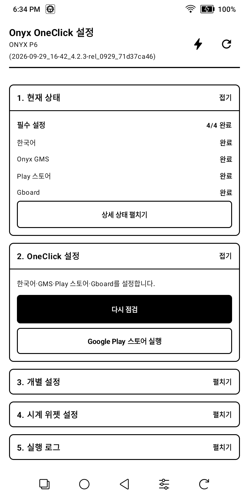
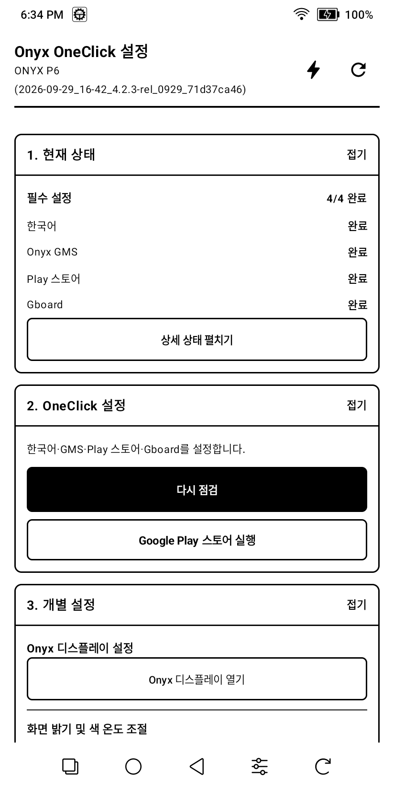
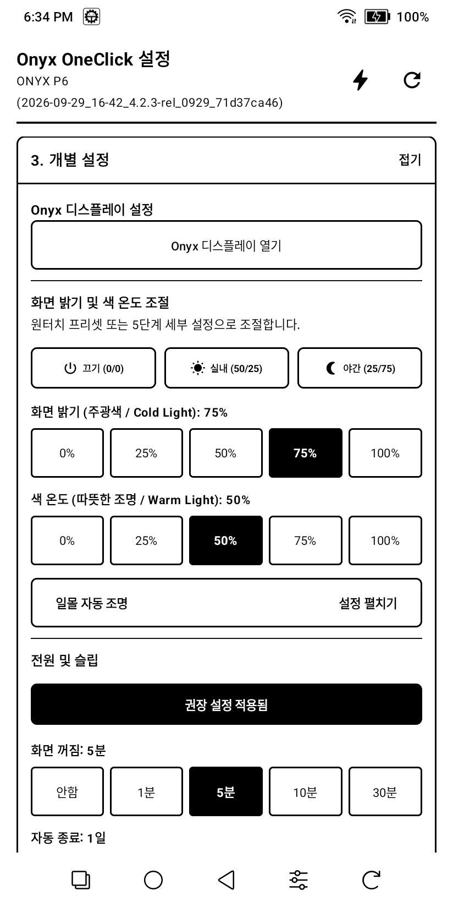
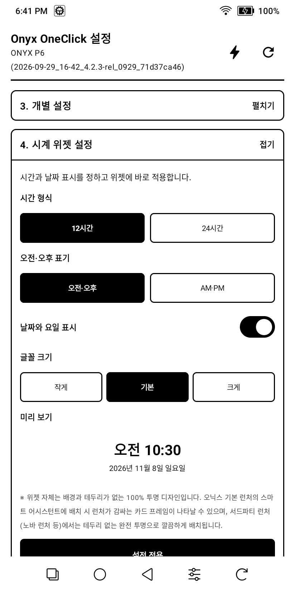
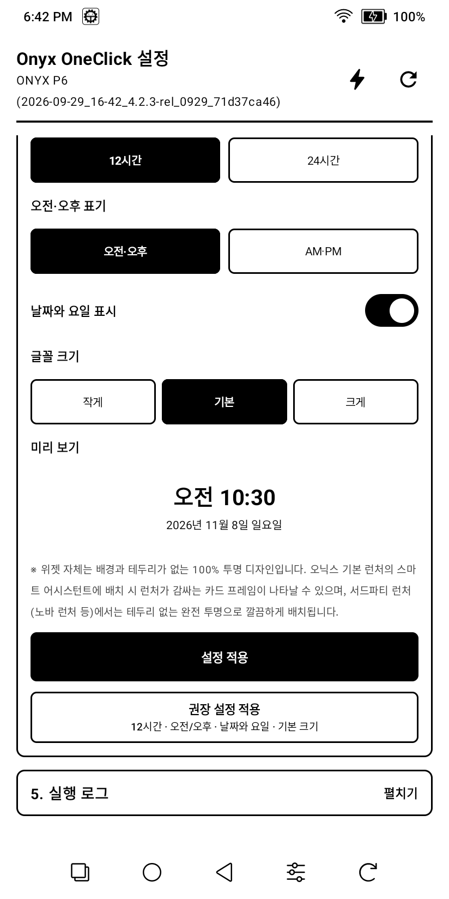
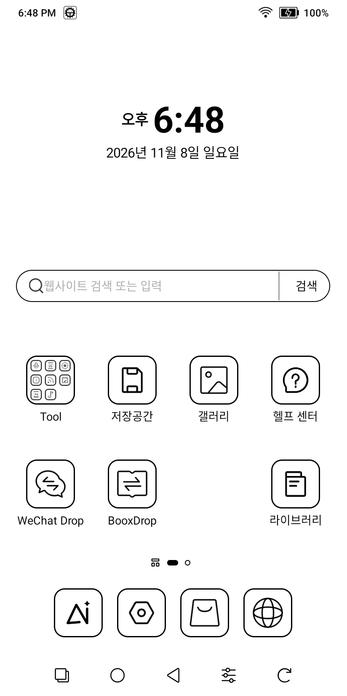

# Onyx OneClick Setup

Onyx 전자책 리더의 초기 설정과 자주 쓰는 기기 옵션을 한곳에서 관리하는 Android 앱입니다.

## 주요 기능

- **설정 상태 확인:** 한국어, Onyx GMS, Play 스토어, Gboard 상태를 확인하고 다시 점검합니다.
- **OneClick 초기 설정:** 한국어 시스템 언어, Onyx GMS, Play 스토어, Gboard 설정을 안내하고 적용합니다.
- **Onyx 디스플레이 바로가기:** Onyx 시스템의 디스플레이 설정 화면을 엽니다.
- **화면 조명:** 끄기, 실내(밝기 50% / 색 온도 25%), 야간(밝기 25% / 색 온도 75%) 프리셋과 밝기·색 온도별 5단계 조절을 제공합니다.
- **일몰 자동 조명:** 일몰에 설정한 조명을 적용하고 일출에 낮 조명으로 복원하도록 예약합니다.
- **전원 관리:** 화면 꺼짐 시간과 자동 종료 시간을 조절하고 권장값(화면 꺼짐 5분, 자동 종료 1일)을 적용합니다.
- **앱 및 설정 관리:** APK/APKS 설치, 설정 백업·복원, 백그라운드 동결 예외 목록을 관리합니다.
- **한국어 시계 위젯:** 12/24시간 형식, 오전·오후 표기, 날짜·요일 표시, 글자 크기를 조절하고 미리보기로 확인합니다.

## 화면 미리보기

### 현재 상태와 OneClick 설정

### Onyx 디스플레이 바로가기

### 디스플레이, 조명, 전원 설정

### 시계 위젯 설정과 미리보기

### 홈 화면에 적용된 시계 위젯

OneClick에서 권장 설정을 적용한 뒤 ONYX P6 홈 메인에서 실제 표시되는 시계와 날짜입니다.

## 캡처 정보

캡처는 ONYX P6 실기기(824 × 1648)에서 촬영했습니다. 기기 모델과 펌웨어에 따라 표시되는 상태 및 일부 메뉴가 다를 수 있습니다.
